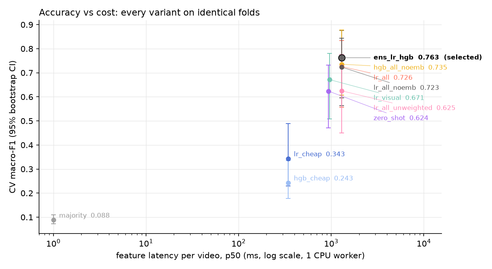

# Task 1: a video classifier that picks the chunker

## How I read the problem

The classifier exists to choose a chunking strategy, so I defined the classes by how a video should be cut up, not by what it is about. A wildlife documentary and a trail cam share a topic but need opposite treatment: one is cut on shots, the other only when something moves.

| Class | Looks like | Chunker it triggers |
|---|---|---|
| talking_head | podcast, interview, anchor desk | transcript topic shifts |
| screen_content | slides, screencast, whiteboard | slide/screen changes |
| edited_narrative | film, documentary, animation, edited shows | shots grouped into scenes |
| sports_broadcast | real sport with field views, scoreboard | plays and events |
| egocentric_continuous | handheld vlog, POV, walk-through | activity changes over sliding windows |
| static_camera | CCTV, trail cam, fixed livestream | motion events, idle time dropped |
| stage_performance | concert, play, magic show | songs/acts, then shots |
| gameplay | rendered game footage, esports | game-state and HUD changes |

## Labels

VideoMME only has topic tags, so there were no labels for this. For each of the 90 videos I rendered a 4x4 contact sheet of timestamped frames, and Claude drafted a label from the sheet, metadata and three transcript excerpts. I reviewed all 90 in a small review page, lowest confidence first, and changed one. The result is imbalanced (40 edited_narrative, 4 gameplay, 0 static_camera), which drove most of the evaluation choices. static_camera is covered only by zero-shot prompts and a simple rule, untested for lack of footage.

## Features

Cheapest first; decode pixels only for what can't be read any other way. Each video is split into 4 windows, and per window I take container metadata, compressed packet sizes and keyframes (the encoder already measured motion and cuts, so no decoding), subtitle speech coverage, an 8-second audio clip through a voice-activity detector, and 4 seeked frames: pixel statistics plus a MobileCLIP2-S0 embedding (ONNX, 20–30 ms per frame on CPU) and its similarity to class prompts. Details and ablations: [feature_engineering.md](feature_engineering.md).

## Model

A soft-voting average of a logistic regression (all features, embedding compressed to 4 PCA dimensions) and gradient-boosted trees (all scalar features), both with balanced class weights, trained on window rows and averaged per video. I picked it from ten variants with a fixed rule, decided before looking at results: among models within one standard error of the best cross-validated score, take the cheapest.

I deliberately did not fine-tune anything. With 90 videos a neural classifier would memorise them, and video transformers or VLMs cost seconds and a GPU per video. A VLM is more useful as the teacher that drafts labels. Text decision models like Jev or Laya don't fit either: the useful signals here are motion, cuts and audio, not text.

## How I measured it

- Macro-F1 is the headline, because accuracy rewards guessing the 44% majority class. Everything comes with a 95% bootstrap interval, since 90 videos is small.
- Two estimates: a stratified 23-video test split locked before training, and 5x5 repeated cross-validation over all 90 videos with each video's windows kept in one fold. The test split is the clean number; CV has much less variance.
- Routing regret, a metric I added. A mistake only matters as much as the wrong chunker hurts: a podcast sent to the shot chunker still gives usable chunks, a CCTV feed sent to the transcript chunker gives nothing. I wrote down how well each chunker works on each true type (a stated prior, `src/vclf/eval/regret.py`) and report the average cost of the routing decisions, plus calibration (ECE) and top-2 accuracy since the router acts on confidence.

## Results

| | Macro-F1 [95% CI] | Accuracy | Top-2 | Routing regret |
|---|---|---|---|---|
| Locked test split, 23 videos | 0.64 [0.38, 0.89] | 0.74 | 0.96 | 0.11 |
| Repeated CV, all 90 videos | 0.79 [0.64, 0.88] | 0.82 | 0.93 | 0.08 |
| Zero-shot MobileCLIP, no training | 0.62 | | | |

What I take from it:

- The mistakes are mostly cheap ones. 9 of 16 errors in CV land in edited_narrative, and the shot chunker still works reasonably on most other types, which is why routing regret stays low.
- The test interval is wide because some classes have one or two test videos. The CV estimate is the one I'd plan around.
- Class weighting matters: without it macro-F1 drops from 0.73 to 0.63.
- The no-decode tier alone is weak (0.34). It adds about 6 points on top of the frames, nearly all on handheld footage. I hoped a cascade could skip frame decoding for most videos; it only manages 13–21% without losing quality.

## Trade-offs

The whole thing is a 45 MB encoder plus a 1 MB classifier and runs on CPU at 1.3 s per video (1.9 s at p95, growing only slowly with length). Going from zero-shot (no training, 0.62) to the full model (0.79 in CV) costs about 0.4 s more per video for the audio and packet features. I stopped tuning after two rounds: with 90 videos, further gains would sit inside the noise.

## Deployment

Queue-fed stateless CPU workers read only the index, four audio clips and sixteen frames through range requests; a router uses the class above 0.5 confidence and a fallback chunker below it. About 1 video per second per 8-core machine (roughly $0.08 per 1,000 videos, estimated). A 1% audit sample feeds retraining behind a CV gate and a canary. Plan and diagram: [deployment.md](deployment.md).

## Limitations, honestly

- 90 videos and 7 present classes. The numbers are directional, not final.
- The test split was scored twice. Round two added variants and a wider tuning grid based on training-CV evidence and fixed a column bug; the first score was 0.52.
- One label per video. Mixed videos (a news show with field footage) are handled by confidence and the fallback, not by segment-level labels.
- The routing-regret costs are my judgement, so I also report plain error rates. The two rank the ten variants almost the same way (Spearman 0.94); by regret alone the trees edge the ensemble by 0.003, well inside the noise.

Code, exact commands and the generated reports: [../README.md](../README.md), [results.md](results.md), [eda.md](eda.md).
