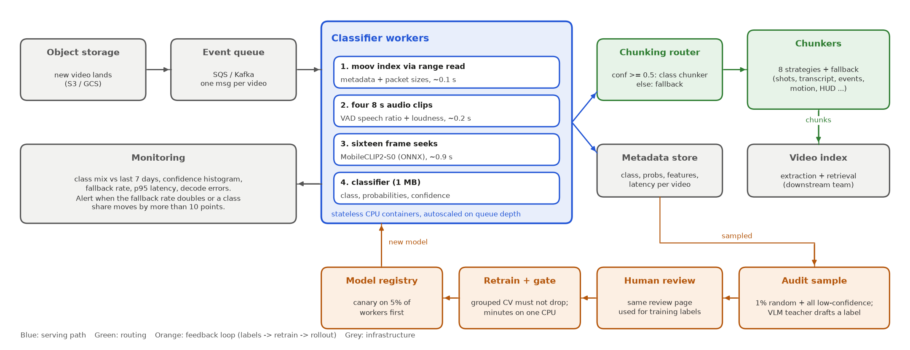

# Deployment plan

The classifier sits between upload and chunking. Its only job is to pick a chunker, so it has to be cheap enough to run on every video and never become the bottleneck.

Editable source: [figures/deployment.drawio](figures/deployment.drawio) (open in diagrams.net).

## Serving path

1. A new video lands in object storage and the bucket notification puts one message on a queue (SQS or Kafka). One message per video keeps everything idempotent: a retry just reclassifies the same file.
2. Stateless CPU workers pull from the queue. Each container holds Python, ffmpeg, onnxruntime, the 45 MB ONNX encoder and the 1 MB classifier. No GPU and no torch.
3. The worker reads only what it needs, using HTTP range requests against the object URL instead of downloading the file:
   - the MP4 index (`moov`) for metadata, packet sizes and keyframe positions,
   - four 8-second audio segments,
   - sixteen short seeks for frames.

   The amount read per video is bounded rather than proportional to file size. (Today the code lets ffprobe demux the whole file for the packet table; reading the `stsz`/`stss` tables from `moov` directly is the first production change, see [feature_engineering.md](feature_engineering.md).)
4. The classifier returns a small JSON record: class, probabilities, confidence, the chunking strategy, the model version and per-stage latency. This is exactly what `python src/main.py predict` prints today.
5. The router sends the video to the chunker for its class when confidence is at least 0.5, and to a generic fallback chunker otherwise (fixed ~30 s windows snapped to shot cuts and transcript boundaries). Because top-2 accuracy is 93–96%, a later version could also run the second-choice chunker on low-confidence videos instead of the fallback, or pick the chunker that minimises expected routing regret rather than the argmax.
6. The record goes to a metadata store next to the video, so chunkers and the index can read the features too (speech coverage, cut rate) without recomputing them.

## Throughput and cost

Measured on an 8-core M3 laptop: 90 videos (12.6+ hours of footage, up to 59 minutes each) in 86–88 s with 4 workers, which is about 1 video per second per machine, or roughly 3,700 videos an hour. A single video takes 1.3 s at the median and 1.9 s at p95.

As a rough cloud estimate, assuming an 8-vCPU instance at about $0.30/hour on demand performs like the laptop (this needs a real benchmark, ARM server cores and the M3 differ): about $0.08 per 1,000 videos, or around 270 machine-hours and $80 for a million videos. Spot capacity would roughly halve that.

It scales linearly because there is no shared state. Workers autoscale on queue depth. At much larger volumes the frame encoder (about a third of the time) is the part worth moving to a shared GPU service that batches frames across videos; everything else stays on CPU.

## Keeping it accurate after launch

The model is small and was trained on 90 videos, so the plan assumes it will drift and needs a loop to keep it honest:

- Audit sample. 1% of videos at random plus every low-confidence video get a draft label from the teacher VLM, reviewed by a person in the same review page used to build the training set. The random 1% gives an unbiased live accuracy estimate; the low-confidence ones are the most useful new training data.
- Retrain and gate. Retraining takes a couple of minutes on one CPU. A new model only ships if its grouped cross-validated macro-F1 and routing regret are no worse than the current model's, measured on the growing label set.
- Canary. New models go to 5% of workers first. If the class mix or fallback rate moves sharply compared to the old model on the same traffic, roll back from the registry.
- New classes. A class with no data (like `static_camera` today) starts as zero-shot prompts plus a simple rule, and becomes a trained class once the audit loop has collected labelled examples.

## Monitoring

Per hour: class mix against the last 7 days, the confidence histogram, fallback rate, p95 latency per stage and decode errors. Two alerts matter most: the fallback rate doubling (the model is seeing something new), and any class share moving more than 10 points (an upstream change, a new customer, or a broken feature).

## Failure handling

- Decode or probe errors: retry once, then send the video to the fallback chunker with the error recorded, so ingestion never blocks on the classifier.
- No audio track or no subtitles: the features are zeroed and flagged, which the model has already seen in training (12 of the 90 videos have no subtitles).
- Index at the end of the file (no "faststart"): one extra range read at the tail, still no full download.

## Data handling

Workers read through short-lived signed URLs or an IAM role and nothing leaves the VPC. The one external call is the teacher VLM in the audit loop, which only sees a contact sheet and a few transcript lines. For customers who don't allow that, the teacher can be a self-hosted VLM, or the audit step can be human-only.
