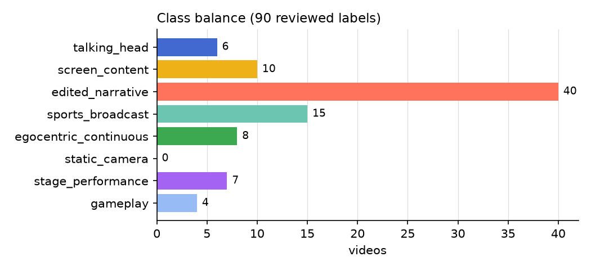
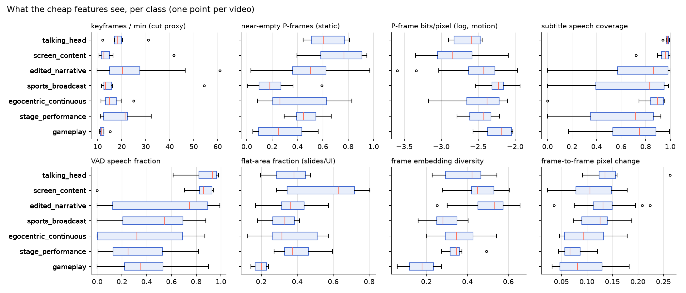
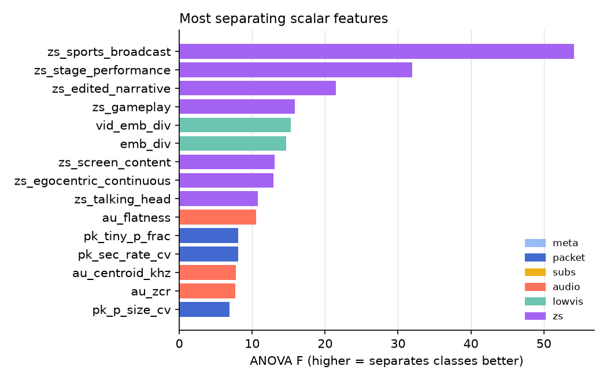
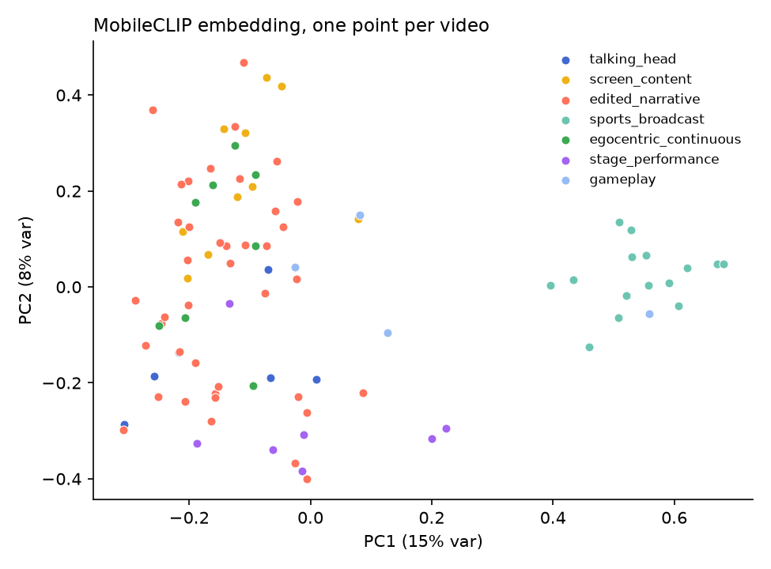
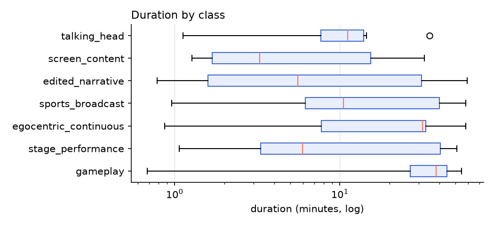

# EDA summary

- **90 videos**, 78 with subtitles. Classes with no examples: static_camera (covered only by zero-shot prompts).
- **Imbalance:** largest/smallest class = 10.0x, so the headline metric is macro-F1 and classifiers use balanced class weights.
- **Window correlation:** windows of the same video have mean embedding cosine 0.79 vs 0.41 across videos, so the 4 windows per video are far from independent; CV groups them by video to avoid leakage.
- **Zero-shot alone** gets 70% video accuracy, the bar a trained model must beat.
- **Most separating scalar features (ANOVA F):** `zs_sports_broadcast` 54.2, `zs_stage_performance` 32.0, `zs_edited_narrative` 21.5, `zs_gameplay` 15.9, `vid_emb_div` 15.3, `emb_div` 14.6, `zs_screen_content` 13.1, `zs_egocentric_continuous` 13.0.

