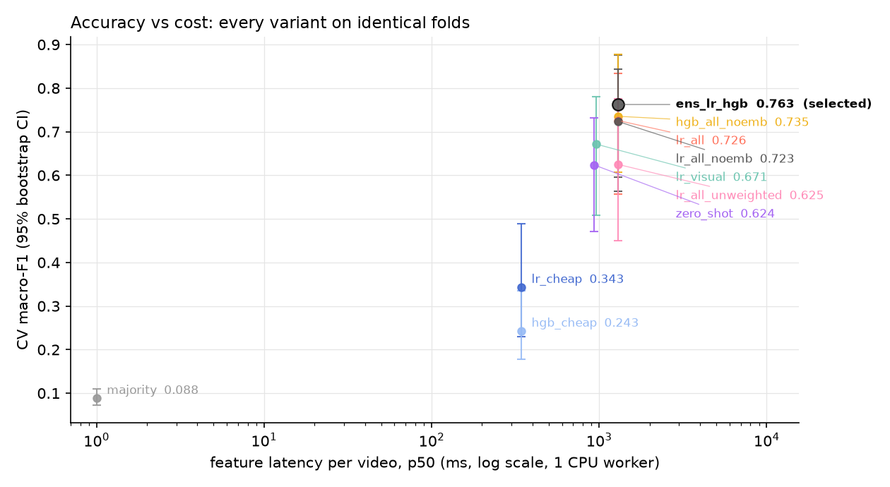
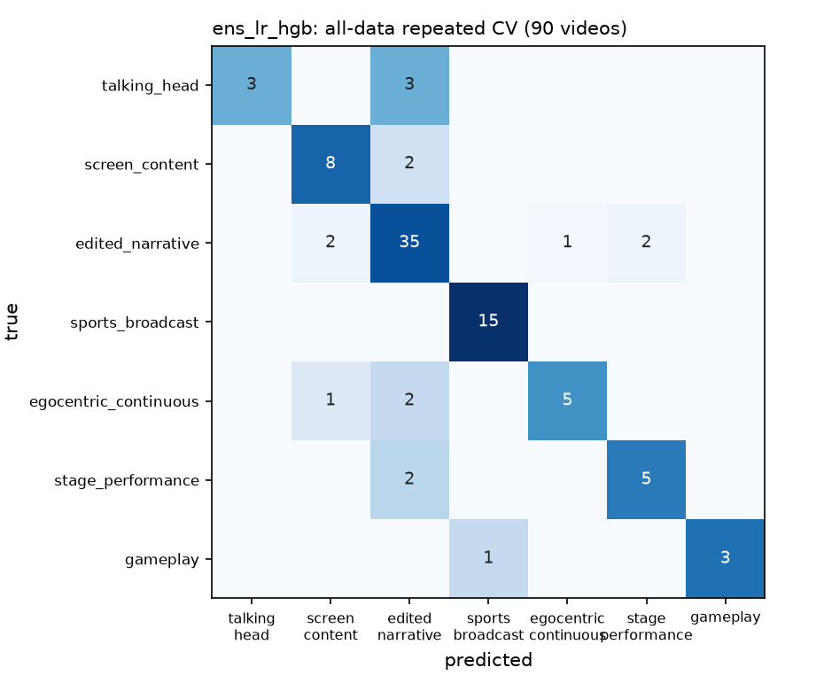
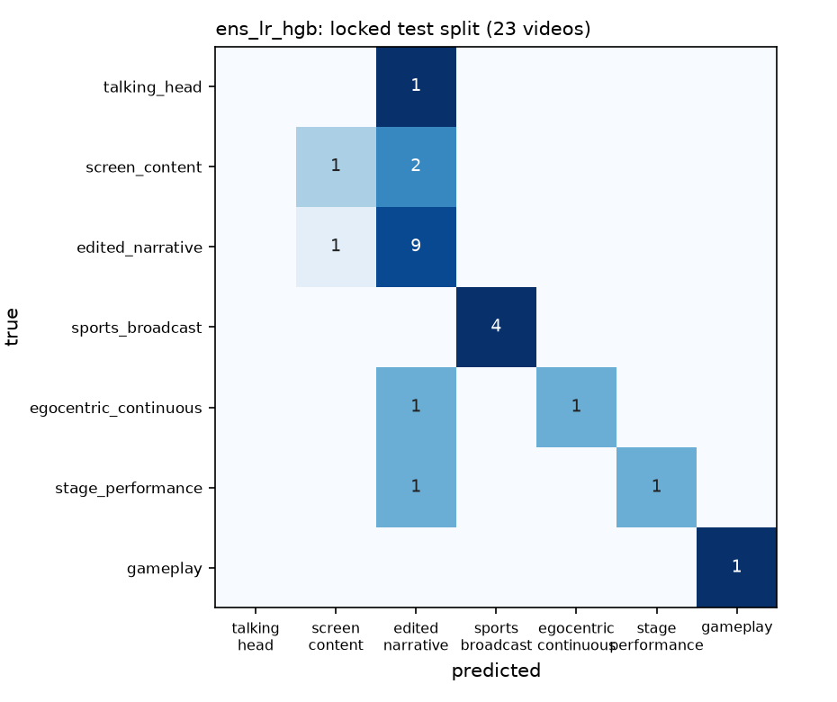
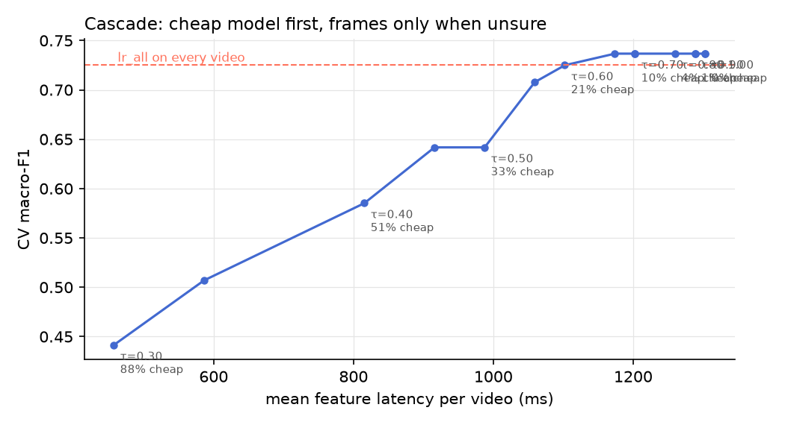

# Results

Selected model: **ens_lr_hgb** (rule: one-standard-error, then lowest latency). Trained on 67 videos, scored once on 23 locked test videos. Model file 1029 KB, classifier time 1.30 ms/video.

| metric | locked test split | all-data repeated CV (90 videos) |
|---|---|---|
| macro-F1 | 0.640 [0.383, 0.887] | 0.788 [0.637, 0.882] |
| balanced accuracy | 0.605 [0.405, 0.870] | 0.752 [0.620, 0.872] |
| accuracy | 0.739 [0.565, 0.913] | 0.822 [0.744, 0.900] |
| top-2 accuracy | 0.957 [0.870, 1.000] | 0.933 [0.878, 0.978] |
| ECE (calibration) | 0.172 [0.120, 0.310] | 0.104 [0.075, 0.195] |
| routing regret | 0.113 [0.039, 0.200] | 0.081 [0.046, 0.119] |
| routing regret, cost-aware router | 0.113 [0.039, 0.200] | 0.079 [0.043, 0.117] |

Zero-shot MobileCLIP alone: macro-F1 0.625 on all 90 videos.

## Every variant (training videos only, 5x5 grouped CV)

| variant | features | CV macro-F1 [95% CI] | regret | ECE | latency p50 ms |
|---|---|---|---|---|---|
| majority | - | 0.088 [0.073, 0.110] | 0.242 | 0.000 | 0 |
| lr_cheap | meta+packet+subs+audio | 0.343 [0.230, 0.488] | 0.272 | 0.114 | 343 |
| hgb_cheap | meta+packet+subs+audio | 0.243 [0.177, 0.336] | 0.266 | 0.212 | 343 |
| zero_shot | zs | 0.624 [0.472, 0.731] | 0.169 | 0.072 | 933 |
| lr_visual | lowvis+zs+emb | 0.671 [0.508, 0.781] | 0.146 | 0.154 | 962 |
| hgb_all_noemb | meta+packet+subs+audio+lowvis+zs | 0.735 [0.607, 0.877] | 0.082 | 0.130 | 1303 |
| lr_all | meta+packet+subs+audio+lowvis+zs+emb | 0.726 [0.557, 0.834] | 0.112 | 0.141 | 1303 |
| lr_all_unweighted | meta+packet+subs+audio+lowvis+zs+emb | 0.625 [0.450, 0.776] | 0.118 | 0.086 | 1303 |
| lr_all_noemb | meta+packet+subs+audio+lowvis+zs | 0.723 [0.563, 0.843] | 0.109 | 0.153 | 1303 |
| ens_lr_hgb | meta+packet+subs+audio+lowvis+zs+emb | 0.763 [0.596, 0.876] | 0.085 | 0.115 | 1303 |

## Per-class F1 (all-data CV)

| class | F1 | videos |
|---|---|---|
| talking_head | 0.67 | 6 |
| screen_content | 0.76 | 10 |
| edited_narrative | 0.83 | 40 |
| sports_broadcast | 0.97 | 15 |
| egocentric_continuous | 0.71 | 8 |
| stage_performance | 0.71 | 7 |
| gameplay | 0.86 | 4 |

## Cascade

Accepting `lr_cheap` when its confidence ≥ 0.60 keeps macro-F1 at 0.725 (vs 0.726 for `lr_all` everywhere), decodes frames for only 79% of videos, and cuts mean latency to 1102 ms.

## Feature latency per video (ms, 1 worker, M3 CPU)

| stage | p50 | p95 |
|---|---|---|
| probe | 28 | 36 |
| packets | 79 | 396 |
| subtitles | 0 | 4 |
| audio | 232 | 267 |
| frames | 471 | 687 |
| encode | 439 | 554 |
| lowvis | 29 | 31 |
| total | 1310 | 1862 |

